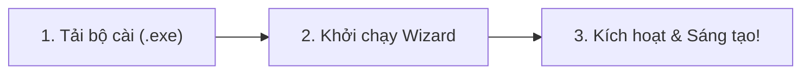

<div align="center">

<a href="https://dubi.ericisme.cloud" target="_blank" rel="noopener noreferrer">
  <picture>
    <source media="(prefers-color-scheme: dark)" srcset="assets/dubisub-logo-dark.svg">
    <source media="(prefers-color-scheme: light)" srcset="assets/dubisub-logo-light.svg">
    
  </picture>
</a>

# DubiSub Desktop Suite

### Generative AI running directly on-device: Automatic video dubbing and subtitle generation
**Trợ thủ AI Dịch thuật, Lồng tiếng và Tự động hóa Video chuyên nghiệp trên Windows**

[](https://github.com/DubiSub/dubisub-releases/releases/latest)
[-0078D6?style=flat-square&logo=windows&logoColor=white)](https://github.com/DubiSub/dubisub-releases/releases/latest)
[](https://dubi.ericisme.cloud)
[-10B981?style=flat-square)](https://dubi.ericisme.cloud)
[](https://dubi.ericisme.cloud)

<br/>

[**🌐 Trang chủ chính thức**](https://dubi.ericisme.cloud) &nbsp;•&nbsp;
[**📥 Tải bản cài đặt (.exe)**](https://github.com/DubiSub/dubisub-releases/releases/latest) &nbsp;•&nbsp;
[**💎 Bảng giá & License**](https://dubi.ericisme.cloud/#pricing) &nbsp;•&nbsp;
[**✨ Tính năng & Công nghệ**](https://dubi.ericisme.cloud/#features) &nbsp;•&nbsp;
[**💬 Hỗ trợ kỹ thuật**](https://dubi.ericisme.cloud/#contact)

---

</div>

## 📌 Tổng quan về DubiSub

**DubiSub** là nền tảng máy trạm (Desktop Software) cao cấp dành riêng cho nhà sáng tạo nội dung, biên tập viên video, đội ngũ Review phim và nhà sản xuất truyền thông số. 

Được xây dựng trên nền tảng AI tăng tốc cục bộ, DubiSub tích hợp sâu các mô hình trí tuệ nhân tạo thịnh hành nhất (**Whisper AI**, **Neural LLM Local**, **Smart Cut Engine**) trực tiếp vào card đồ họa GPU của bạn. Điều này mang lại hiệu suất dịch thuật và cắt dựng video thần tốc với **độ trễ mạng bằng 0** và **bảo mật dữ liệu tuyệt đối 100%**.

> 🔒 **Thông báo phân phối**: Kho lưu trữ (repository) này là kênh phát hành chính thức của DubiSub, chỉ cung cấp các gói cài đặt đã đóng gói và chữ ký số (.exe / .zip). Để tìm hiểu về giấy phép doanh nghiệp hoặc kích hoạt phần mềm, vui lòng truy cập [dubi.ericisme.cloud](https://dubi.ericisme.cloud).

---

## ⚡ Tính năng cốt lõi

```
┌────────────────────────────────────────────────────────────────────────┐
│  🎬 Video đầu vào ──► 🎙️ Whisper (Local) ──► 🧠 LLM Dịch phim         │
│                                                     │                  │
│  🚀 Xuất 4K / Subtitle ◄── ✂️ Cắt nhịp tự động ◄────┘                  │
└────────────────────────────────────────────────────────────────────────┘
```

- **🎙️ Nhận diện giọng nói siêu chính xác (99.2%)**: Ứng dụng mô hình `Whisper Large-v3` tối ưu riêng cho tiếng Việt, tự động tách lời thoại kể cả trên nền nhạc phim hoặc tạp âm lớn.
- **🧠 Dịch thuật ngữ cảnh sâu & Phong cách điện ảnh**: Mô hình Local Neural LLM hiểu rõ ẩn ý, tiếng lóng, văn hóa bản địa và giữ trọn mạch cảm xúc của tác phẩm mà không bị khô cứng như dịch máy thông thường.
- **✂️ Tự động hóa Review Phim & Cắt Shorts/Reels**: Hệ thống AI tự nhận diện nhịp chuyển cảnh, tạo điểm nhấn cao trào, ghép giọng lồng tiếng tự động và xuất video khung hình dọc (9:16) hoặc ngang (16:9) chỉ trong vài cú nhấp chuột.
- **🎨 Phụ đề Karaoke & Song ngữ chuyên nghiệp**: Tùy biến định dạng phụ đề linh hoạt (`.srt`, `.ass`, `.vtt`), hiệu ứng chuyển màu chữ theo từng âm tiết (Karaoke timeline) chuẩn từng mili-giây.
- **🔒 100% On-Device & Zero Cloud Leak**: Dữ liệu video, âm thanh và kịch bản của bạn không bao giờ tải lên bất kỳ đám mây nào. Toàn bộ tiến trình tính toán diễn ra ngay trên phần cứng của bạn.

---

## 📥 Tải xuống DubiSub mới nhất

Các gói cài đặt chính thức dành cho hệ điều hành **Windows 64-bit**:

| Gói phân phối | Định dạng | Dung lượng | Tương thích | Tải về |
| :--- | :---: | :---: | :---: | :---: |
| **DubiSub Installer (Setup)**<br/><sub>*Khuyến nghị cho người dùng cá nhân & studio*</sub> | `.exe` | ~88.8 MB | Windows 10/11 x64 | [**Tải bản cài đặt (.exe)**](https://github.com/DubiSub/dubisub-releases/releases/download/v1.0.0/DubiSub-Setup-v1.0.0.exe) |
| **DubiSub Portable Edition**<br/><sub>*Bản giải nén dùng ngay, không cần quyền Admin*</sub> | `.zip` | ~376 MB | Windows 10/11 x64 | [**Tải file Portable (.zip)**](https://github.com/DubiSub/dubisub-releases/releases/download/v1.0.0/DubiSub-v1.0.0-Portable-win64.zip) |

> 💡 **Khởi động nhanh**: Nếu bạn mới tải lần đầu, hãy cài đặt và chọn gói **Trải nghiệm (Free)** trên giao diện để sử dụng ngay các tính năng cơ bản hoàn toàn miễn phí.

---

## 🚀 Hướng dẫn cài đặt trong 3 bước



1. **Bước 1 — Tải bộ cài**: Chọn liên kết tải gói `.exe` ở bảng phía trên từ mục [Releases](https://github.com/DubiSub/dubisub-releases/releases/latest).
2. **Bước 2 — Cài đặt vào hệ thống**: Nhấp đúp vào tệp tin `DubiSub-Setup.exe` và làm theo hướng dẫn của trình cài đặt trực quan.
3. **Bước 3 — Bắt đầu sử dụng**: Khởi động biểu tượng **DubiSub** ngoài màn hình Desktop. Bạn có thể đăng nhập tài khoản của mình tại [dubi.ericisme.cloud](https://dubi.ericisme.cloud) hoặc nhập mã License Key nếu đã sở hữu.

---

## 💻 Yêu cầu hệ thống & Tương thích phần cứng

DubiSub được thiết kế để khai thác tối đa sức mạnh của phần cứng hiện đại thông qua các backend tính toán chuyên dụng:

| Phần cứng | Cấu hình tối thiểu | Cấu hình khuyến nghị |
| :--- | :--- | :--- |
| **Hệ điều hành** | Windows 10 64-bit (20H2+) | Windows 11 64-bit (Bản mới nhất) |
| **Bộ vi xử lý (CPU)** | Intel Core i5 / AMD Ryzen 5 thế hệ 8+ | Intel Core i7 / AMD Ryzen 7 thế hệ 11+ |
| **Bộ nhớ RAM** | 8 GB RAM | 16 GB - 32 GB RAM tốc độ cao |
| **Card đồ họa (GPU)** | NVIDIA GTX 1650 (4GB VRAM) hoặc CPU Mode | NVIDIA RTX 3060 / 4060 trở lên (8GB+ VRAM) |
| **Tăng tốc phần cứng** | CUDA 12.x / DirectML / CPU Fallback | NVIDIA CUDA với Tensor Cores tối ưu |
| **Ổ cứng lưu trữ** | 4 GB trống (SSD) | 15 GB trống (NVMe SSD cho cache video) |

---

## 🛡️ Cam kết an toàn & Chữ ký số

- **100% Sạch & Không mã độc**: Tất cả tệp tin phát hành trên kênh GitHub này đều được biên dịch tự động trong môi trường CI/CD khép kín và quét qua hệ thống kiểm tra bảo mật nghiêm ngặt.
- **Xác minh mã băm (Checksum SHA-256)**: Mỗi bản phát hành đi kèm với tệp `checksums.txt` tại trang Release giúp bạn đối chiếu tính toàn vẹn của tệp tải về trước khi chạy.
- **Thông báo Windows SmartScreen**: Đối với những bản phát hành mới (chưa tích lũy đủ số lượt tải từ cộng đồng Microsoft), màn hình Windows SmartScreen có thể xuất hiện bảng thông báo màu xanh. Hãy bấm **More info** (Xem thêm) ➔ chọn **Run anyway** (Vẫn chạy) để tiếp tục.

---

## 📄 Bản quyền & Sở hữu trí tuệ

- Bản quyền phần mềm © 2026 **DubiSub Team**. Mọi quyền được bảo lưu.
- DubiSub là giải pháp thương mại được cấp phép có điều kiện. Mã nguồn, tài nguyên đồ họa và các thuật toán nhúng là tài sản sở hữu trí tuệ độc quyền của DubiSub.
- Mọi hành vi biên dịch ngược, can thiệp mã máy, phân phối lại hoặc bẻ khóa giấy phép đều vi phạm pháp luật và bị nghiêm cấm theo quy định quốc tế về quyền tác giả.

---

## 🌐 Liên kết quan trọng

- 🌍 **Website chính thức**: [https://dubi.ericisme.cloud](https://dubi.ericisme.cloud)
- 💳 **Mua gói & Nâng cấp License**: [Bảng giá DubiSub](https://dubi.ericisme.cloud/#pricing)
- 🛠️ **Quản lý thiết bị & Tài khoản**: [Dashboard Tài Khoản](https://dubi.ericisme.cloud/admin)
- 📮 **Email hỗ trợ kỹ thuật**: [contact@ericisme.cloud](mailto:contact@ericisme.cloud)
- 🐛 **Báo cáo lỗi phiên bản**: [Tạo Issue trên GitHub](https://github.com/DubiSub/dubisub-releases/issues)

<div align="center">
  <sub>Được phát triển với sự tỉ mỉ và đam mê bởi <b>DubiSub Team</b>. Mang công nghệ AI hàng đầu đến bàn làm việc của bạn.</sub>
</div>
